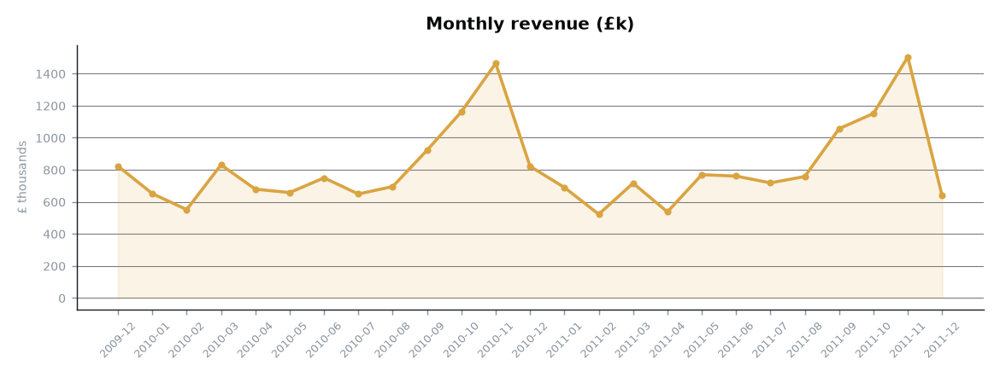
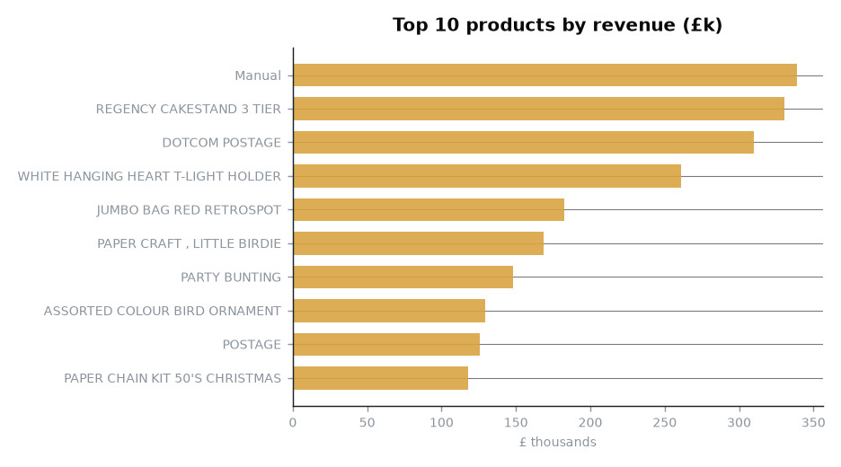
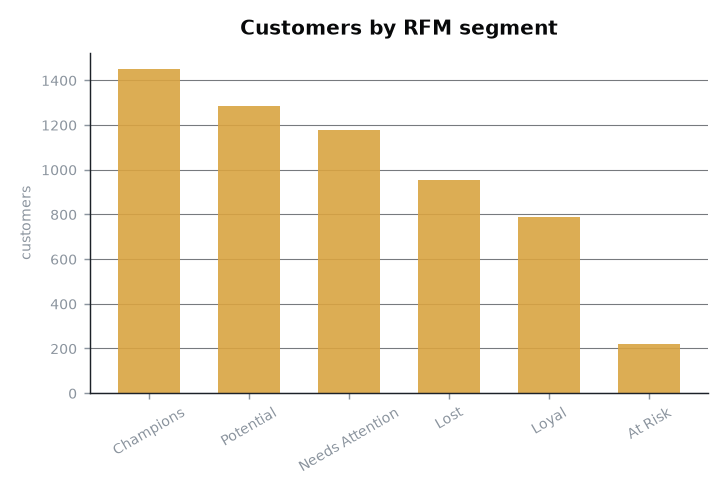
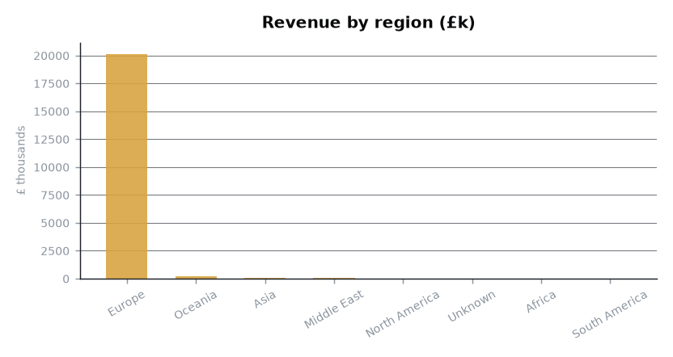
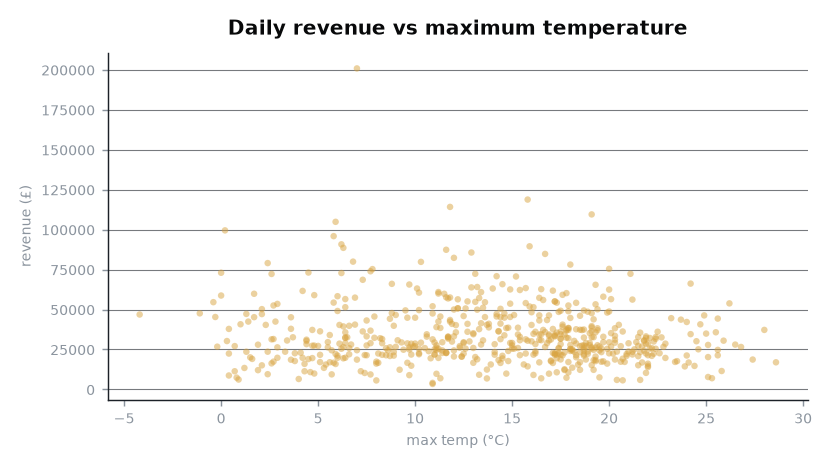

# UK Retail Analytics — IBM Data Engineering Capstone


A complete data platform that ingests **four heterogeneous sources**, cleans and
models them into a **star-schema warehouse**, gates the result with **18
data-quality checks**, and publishes **five business marts** and a dashboard.

Everything runs on one laptop. No cloud account, no Docker, no Spark cluster,
no scheduler daemon.

```
extract → stage → quality → load → marts → report
                                     18/18 gates · 1,033,036 fact rows
```



---

## Quickstart

```powershell
git clone https://github.com/imShoaibArshad/ibm-data-engineering-capstone.git
cd ibm-data-engineering-capstone

.\setup.ps1          # create .venv, install dependencies, register `retailde`
.\run_pipeline.ps1   # run the whole pipeline
```

Linux/macOS:

```bash
./setup.sh && ./run_pipeline.sh
```

`setup` installs the package **editable**, so `retailde` and
`python -m retailde` both work — but only once the virtualenv is active.
Activate it to use the short form of the commands below:

```powershell
.venv\Scripts\Activate.ps1      # PowerShell     (Windows)
# source .venv/bin/activate     # bash           (Linux/macOS)
```

If activation is blocked by execution policy, call the interpreter directly —
`.\.venv\Scripts\python.exe -m retailde ...` — everything works the same way.

Then inspect the result:

```bash
retailde status            # what was built
retailde quality           # re-run the 18 gates
python -m pytest tests     # 121 tests, ~26s, fully offline
```

**Measured on a cold start** (empty `data/`, everything downloaded):

| | |
|---|---|
| Wall clock | **525.4 s** — of which **461.3 s** is downloading the 45 MB UCI archive |
| Warm re-run (everything cached) | **27.1 s** |
| Warehouse load | 24.0 s full / **0.4 s** incremental (0 rows, keys stable) |
| Test suite | **121 passed in ~26 s**, no network |

---

## Why this project

The IBM Data Engineering curriculum covers ingestion, warehouses, quality,
orchestration and reporting — but the capstone normally assumes cloud
infrastructure (IBM Cloud, Db2, Spark on a cluster). This build keeps **every
learning outcome** and drops the cloud requirement, because the goal is
something that runs on the machine it was built on.

Where the usual stack was replaced, and why:

| Curriculum tool | Here | Why |
|---|---|---|
| Apache Spark | **DuckDB** | Real columnar, out-of-core execution over Parquet — but a single binary with no cluster, no JVM, no daemon |
| Airflow / scheduler daemon | **networkx DAG runner** | Topological ordering, retries, exponential backoff, `start`/`stop` selectors — the part that matters — in 250 lines that actually run |
| Db2 on cloud | **DuckDB file** | A dimensional warehouse with referential integrity, SCD2 and watermarks, in `data/warehouse/retail.duckdb` |
| Cloud object storage | **Zoned Parquet + raw archive** | The same `raw → staging → warehouse → marts` separation, on a filesystem |
| IBM Cloudant / NoSQL | *(not used)* | Nothing here needed a document store; forcing one in would be theatre |

Every replacement is stated openly rather than papered over.

---

## The four sources

Four different ingestion patterns, which is the point — a platform that only
handles one shape of input has not really solved ingestion.

| # | Source | Adapter | Size | Notes |
|---|---|---|---|---|
| 1 | **UCI Online Retail II** | `bulk_file` (ZIP → XLSX) | 45,622,418 B | The fact spine. 1,067,371 rows over two worksheets, 2009-12-01 → 2011-12-09 |
| 2 | **Open-Meteo** (London) | `rest_api` (JSON) | 20,508 B | Positional array payload, keyless, 739/739 days |
| 3 | **Frankfurter / ECB** | `rest_api` (JSON) | 21,411 B | GBP→USD/EUR, **date-keyed** dict (opposite shape to #2) |
| 4 | **Bank of England Bank Rate** | `html_page` (scrape) | 55,599 B | 258-row HTML table, two-digit-year dates, effective-dated series |

Sources 2–4 need **no API key and no account**, which is a hard requirement of
this project.

Provenance for every fetch — URL, timestamp, byte count, SHA-256, attempt count
— is written to `data/raw/_manifest.json` and asserted by a quality gate.

### A source that was rejected

The first candidate for source #4 was GOV.UK bank holidays. It parses cleanly,
but the published page only covers **2019–2028** — zero overlap with a dataset
that ends in 2011. A coverage check could never pass, so it was replaced with
the Bank of England rate history, which reaches back to 1975.

---

## Architecture

```
                    ┌────────────────── 4 independent extract tasks ──────────────────┐
                    │                                                                 │
   UCI ZIP/XLSX ────┤                Open-Meteo JSON ──┐                              │
   (45 MB)          │                ECB FX JSON ──────┼──► stage.*  → Parquet        │
   BoE HTML ────────┘                                  │        │                     │
                                                       │        ▼                     │
                                                       │  quality.staging  (11 gates) │
                                                       │        │                     │
                                                       │        ▼                     │
                                                       │  load.warehouse  (DuckDB)    │
                                                       │        │                     │
                                                       │        ▼                     │
                                                       │  quality.warehouse (7 gates) │
                                                       │        │                     │
                                                       │        ▼                     │
                                                       └──► marts.build → report      │
```

Zones on disk:

```
data/raw/        vendor bytes, untouched          + _manifest.json (SHA-256 provenance)
data/staging/    typed, deduplicated Parquet      + per-table stats JSON
data/warehouse/  retail.duckdb  (star schema)
data/marts/      5 business marts as Parquet
data/reports/    charts + dashboard.html + kpis.json   ← committed, renders in this README
```

Extract and parse are deliberately separate: transforms never touch the
network, so the entire pipeline is testable offline against fixtures.

---

## The warehouse

A classic Kimball star schema — one fact, conformed dimensions, and
date-grained context tables hanging off `dim_date`.

```
                        ┌── dim_date ──┬── dim_weather   (date grain)
                        │              ├── dim_fx        (date grain)
                        │              └── dim_bank_rate (SCD2, as-of join)
                        │
   dim_customer ────────┤
   dim_product  ────────┼── fact_transaction   1,033,036 rows
   dim_country  ────────┘
```

| Table | Rows | |
|---|---:|---|
| `fact_transaction` | **1,033,036** | every staged row, cancellations and returns flagged not deleted |
| `dim_date` | 739 | continuous, no gaps |
| `dim_customer` | 5,943 | 5,942 identified + **1 unknown member** |
| `dim_product` | 5,304 | most-frequent description wins |
| `dim_country` | 43 | region from `config/country_regions.csv` |
| `dim_weather` | 739 | 100% of the calendar |
| `dim_fx` | 523 | 98.87% of weekdays |
| `dim_bank_rate` | 258 | 1975 → 2025, effective-dated |

### Three decisions worth explaining

**Surrogate keys are dense integers, not hashes.** `customer_key` 1…N reads far
better in a query than a 20-digit hash. Stability under incremental load is
preserved by append-only `map_*_key` tables: existing members keep their key
forever, new members take `max + 1`. Rebuilds therefore never renumber a
dimension underneath facts that already point at it — and a test asserts it.

**The unknown member is real.** 235,151 rows (22.8%) have no `Customer ID`.
Dropping them would erase **£3,101,456.18** of revenue. Instead `dim_customer`
carries a member with `is_unknown = true`, so those rows stay visible.
*(Note: `NULL = NULL` is never true in SQL, so the loader joins on
`COALESCE(customer_id, -1)` rather than the raw column — a test covers exactly
this trap.)*

**The Bank Rate joins as-of, not by equality.** The rate changes ~5 times a
year; an equality join would match almost nothing. Each calendar day inherits
the most recent decision at or before it, producing an SCD2-style effective
range with exactly one open-ended row.

---

## Data-quality gates

18 checks in two phases. Any failure aborts the run with **exit code 1** — a
gate that logs and continues is decoration.

**Staging (11)**

| Gate | Observed | Threshold |
|---|---|---|
| transaction row count | 1,033,036 | ≥ 1,000,000 |
| null `customer_id` rate | 0.2276 | ≤ 0.25 |
| duplicate rate after cleaning | 0.0 | ≤ 0.001 |
| valid sales have positive revenue | 1,007,913 | > 0 |
| no null `invoice_date` | 0 | = 0 |
| date range sane | 2009-12-01..2011-12-09 | min ≤ max |
| weather coverage of calendar | 1.0 | ≥ 0.95 |
| **FX coverage of weekdays** | 0.9887 | ≥ 0.95 |
| bank rate rows parsed | 258 | > 0 |
| bank rate covers window | 0.5% | rate in force at start |
| every enabled source landed | 4/4 | all present |

**Warehouse (7)**

| Gate | Observed | Threshold |
|---|---|---|
| fact rows == staged rows | 1,033,036 | = 1,033,036 |
| referential integrity | **0 orphans** | = 0 |
| revenue reconciles staging → warehouse | £20,476,260.45 | exact match |
| all countries mapped to a region | 0 unmapped | = 0 |
| bank rate resolved for every fact row | 0 nulls | = 0 |
| no failed ETL runs recorded | 0 | = 0 |
| unknown-customer revenue accounted for | £3,101,456.18 | > 0 |

**Thresholds come from profiling this dataset, not from intuition.** The
`null_customer_id_rate_max` ceiling is 0.25 because the source really ships
0.2276 — a gate at 0.10 would fail forever and get switched off; a gate at
0.50 would catch nothing.

**Denominators matter.** The ECB publishes FX only on target-area working days.
Measured against calendar days this source scores **70.8%** and the gate could
never pass; measured against weekdays it is **98.87%**. The check measures
weekdays and says so in its output.

---

## Findings

Things the pipeline turned up that were not known when it was designed.

### 1. The source file double-publishes nine days

The vendor splits the transaction log into `Year 2009-2010` (ends 2010-12-09)
and `Year 2010-2011` (starts 2010-12-01). **Those ranges overlap by nine
days**, so every transaction in 2010-12-01…2010-12-09 is published twice.

The profiler splits duplicates by cause rather than reporting one lumped number:

| Cause | Rows removed |
|---|---:|
| Cross-sheet (the nine-day overlap) | 22,844 |
| Within-sheet repetition | 11,491 |
| **Total** | **34,335** |

The overlap is only detectable if you measure sheet date ranges **before**
deduplication — removing the duplicates makes the two sheets look perfectly
contiguous and the defect vanishes from the profile. That ordering is
deliberate, and a test pins it.

### 2. Business events are retained, defects are not

Cancellations, returns and non-positive prices are **flagged, never deleted**
— removing them would make revenue unreconcilable, because the returns that
offset it would be gone. 25,123 rows are excluded from revenue but all remain
in `fact_transaction`.

- All-rows revenue: **£18,855,533.70**
- Valid-sale revenue: **£20,476,260.45** (the difference is returns/credits)

Exact duplicates are the one category removed, because they are a defect in
the published file rather than a business event.

### 3. The Bank Rate was frozen throughout

The rate was **0.50% for the entire window** (set 2009-03-05, held until
2016 — post-crisis policy). The as-of join is therefore a constant here. That
is historically correct, and the full 258-row dimension still spans 1975–2025.
The join machinery is the useful part; the flatness of this particular period
is a property of the data.

---

## Results




| KPI | Value |
|---|---:|
| Revenue (valid sales) | **£20,476,260.45** |
| Orders (valid sales) | 40,077 |
| Identified customers | 5,942 |
| Units sold | 11,205,148 |
| Products | 5,304 |
| Countries | 43 |
| Calendar days | 739 (2009-12-01 → 2011-12-09) |




The full interactive-but-static dashboard is at
[`data/reports/dashboard.html`](data/reports/dashboard.html) — no JavaScript,
opens straight from disk.

---

## Marts

Five marts, rebuilt wholesale from the fact table (each is a pure function of
it, so recomputing is always correct and costs milliseconds).

| Mart | Rows | Question it answers |
|---|---:|---|
| `mart_monthly_revenue` | 127 | How did trading evolve, by region? |
| `mart_daily_kpis` | 604 | Is trading seasonal — does weather move it? |
| `mart_product_performance` | 4,916 | Which products actually earn? |
| `mart_customer_segments` | 5,879 | Who are the customers, and who is drifting away? (5-tier RFM) |
| `mart_region_summary` | 43 | Which markets matter outside the UK? |

Each is exported to `data/marts/*.parquet` for downstream tools that do not
speak DuckDB.

---

## Orchestration

`retailde plan` prints the DAG without running anything:

```console
$ retailde plan
13 tasks:

   1. extract.uci_online_retail    UCI Online Retail II [bulk_file]
      deps: -
   2. extract.open_meteo_london    Open-Meteo London Daily Weather [rest_api]
      deps: -
   ...
   9. quality.staging              assert source volume, dirt tolerances, coverage
      deps: stage.transactions, stage.weather, stage.fx, stage.bank_rate
  10. load.warehouse               build star schema in DuckDB
      deps: quality.staging
```

Behaviours worth noting, each covered by tests:

- **Cycles and unknown dependencies** are reported as errors, not discovered as hangs
- **Retries with exponential backoff** (1 s, 2 s, 4 s …) — the failures that
  actually occur are rate limits and dropped connections
- **A failure skips only what depends on it.** If the BoE scrape fails you
  still learn whether the other three sources extracted
- **`--start` / `--stop`** resume mid-pipeline; tasks outside the slice are
  treated as already done
- **`--dry-run`** prints the plan and executes nothing

```powershell
.\run_pipeline.ps1 -DryRun
.\run_pipeline.ps1 -Start load.warehouse
.\run_pipeline.ps1 -Stop  quality.staging
```

Exit codes: `0` success · `1` quality gate failed · `2` run errored.

---

## Testing

```console
$ python -m pytest tests
........................................................................ [ 59%]
.................................................                        [100%]
121 passed in 26.24s
```

Entirely offline. The synthetic fixtures reproduce every defect found in the
real source in miniature — mixed Excel types, null customer IDs, negative
quantities, whitespace, exact duplicates, and two worksheets that overlap.

| File | Covers |
|---|---|
| `test_transform.py` | identifier repair, dedup attribution, worksheet overlap, all four parsers |
| `test_warehouse.py` | FK integrity, continuous calendar, SCD2 contiguity, key stability, incremental idempotency |
| `test_quality.py` | gates pass on good data **and fail on bad data** |
| `test_orchestrator.py` | ordering, cycles, retry/backoff, failure propagation |
| `test_extract.py` | caching, offline mode, retries, provenance, config validation |
| `test_pipeline.py` | full DAG end-to-end, gate aborts, selectors |

A suite that only asserts gates pass is testing nothing — hence
`test_quality.py` deliberately breaks the data and confirms the gate fires.

---

## Project layout

```
ibm-data-engineering-capstone/
├── config/
│   ├── sources.yaml           # source catalogue + quality thresholds
│   └── country_regions.csv    # reference data (a missing row fails a gate)
├── src/retailde/
│   ├── extract/               # 3 adapters: bulk_file, rest_api, html_page
│   ├── transform/             # raw → Parquet (transactions, weather, fx, bank_rate)
│   ├── warehouse/             # star-schema DDL + loaders
│   ├── quality/               # 18 gates, two phases
│   ├── marts/                 # 5 business marts
│   ├── report/                # matplotlib charts + static HTML dashboard
│   ├── orchestrator.py        # DAG runner: ordering, retries, backoff
│   ├── pipeline.py            # wires the stages into the DAG
│   └── cli.py                 # `retailde` command
├── tests/                     # 121 offline tests
├── data/                      # zones (git-ignored except .gitkeep + reports)
├── run_pipeline.sh / .ps1
├── setup.sh / .ps1
└── pyproject.toml
```

---

## Running individual stages

```bash
retailde extract --force      # re-fetch every source
retailde stage                # raw → Parquet
retailde quality --phase all  # 18 gates; exit 1 if any fail
retailde load --mode incremental   # append above the watermark
retailde marts                # rebuild the 5 marts
retailde report               # charts + dashboard
retailde status               # what exists right now
retailde plan                 # print the DAG
retailde clean --yes          # delete every generated artefact
```

`--root PATH` on every command points the whole pipeline at another directory,
which is how the tests run against temporary fixtures.

---

## Limitations, stated plainly

- The transaction source is a **static historical dataset** (2009–2011).
  Incremental loading is a real, tested mechanism — a second run loads 0 rows
  and renumbers nothing — but no new data will arrive. The watermark exists
  because the pattern matters, not because this data grows.
- Bank Rate is **constant across the analysis window**, so it contributes no
  variance. It is included as a correct effective-dated join, not as a signal.
- Weather is **London only**, matched to a nationwide retailer. It is a proxy.
- No Spark, no Docker, no cloud — see the mapping table above. DuckDB handles
  1M rows comfortably; it is not a substitute for a distributed engine on data
  100× larger, and this project does not claim otherwise.

---

## Licence

MIT — see [`LICENSE`](LICENSE).

Data © [UCI Machine Learning Repository](https://archive.ics.uci.edu/dataset/502/online+retail+ii)
(Ángel Arrese and Javier Reyes, 2015). Weather by
[Open-Meteo](https://open-meteo.com/). Exchange rates by the
[ECB via Frankfurter](https://www.frankfurter.app/). Bank Rate from the
[Bank of England](https://www.bankofengland.co.uk/boeapps/database/Bank-Rate.asp).
